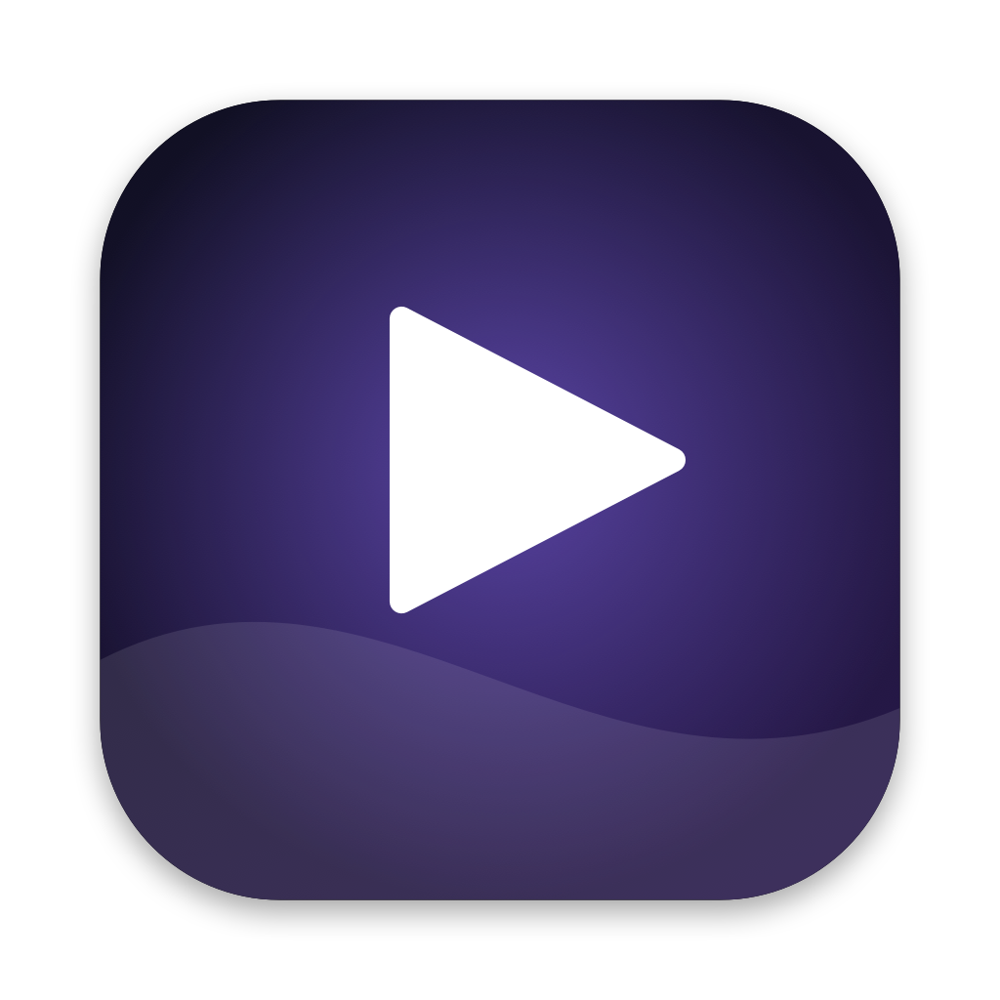

<p align="center">
  
</p>

<h1 align="center">StayLive</h1>

<p align="center">
  Live video wallpapers for macOS: on your desktop, on your lock screen, and as a screen saver with sound.
</p>

<p align="center">
  <a href="https://pradyumnagarg.github.io/StayLive/"><b>Website</b></a> ·
  <a href="https://github.com/PradyumnaGarg/StayLive/releases/latest"><b>Download</b></a>
</p>

---

StayLive turns any video into a moving wallpaper. Drop a clip into the library and use it on:

| Where | What you get |
|---|---|
| **Desktop** | The video plays behind your icons on every display, with optional sound. It pauses automatically when the desktop is covered, the screen is locked or asleep, and optionally on battery. |
| **Lock screen** | The video plays on the macOS lock screen and slows down smoothly when you unlock, just like Apple's built-in Aerials. |
| **Screen saver** | A full-screen screen saver that plays the video with sound and fades out the moment you're back. |

## Features

- Built-in animated wallpapers generated on your Mac, plus your own videos via drag and drop
- Home with a featured carousel and what's showing where; Library with hover previews and a details panel
- One click to use a wallpaper everywhere, or pick desktop / lock screen / screen saver individually
- Automatic lock-screen conversion to the format macOS expects, with progress and a time estimate
- Conversions run in a queue in the background; already-converted videos switch instantly
- Sound on the desktop and in the screen saver, from your main display only (no echo across monitors)
- Menu bar controls: play/pause, quick switcher, volume
- Pause on battery, launch at login
- Your videos appear as their own **StayLive** category in System Settings → Wallpaper, next to Apple's Aerials

## Requirements

- A Mac with Apple silicon
- macOS 14 Sonoma or later (developed and tested on macOS 27)
- For the lock screen: macOS with Aerial wallpapers (Apple's Aerial list must have been downloaded once, which System Settings → Wallpaper does automatically)

## Install

1. Download the latest `StayLive-x.y.z.dmg` from [Releases](../../releases) and open it.
2. Drag **StayLive** onto the **Applications** folder in the window that appears.
3. Open it. Because StayLive isn't notarized by Apple, macOS will block the first launch:
   open **System Settings → Privacy & Security**, scroll down and click **Open Anyway** next to StayLive.

StayLive lives in your menu bar (look for the ▶︎ icon). Open the library from there.
It starts automatically when you log in, so your desktop keeps playing after a restart; you can turn that off in Settings.

## Using it

1. Click **+** (or drag videos onto the window) to add them to your library.
2. Browse with the carousel and press **Use Everywhere**, or the desktop / lock screen / screen saver buttons.
3. **Lock screen:** the first time you use a video there, StayLive converts it to 4K · 240 fps (a few minutes). After that, switching is instant.
4. **Screen saver:** after choosing a video, pick **StayLive** in System Settings → Screen Saver. Turn sound on in StayLive → Settings → Screen Saver.

## How it works

The short version:

- **Desktop:** a borderless, click-through window per display, placed at the desktop level behind your icons.
- **Lock screen:** macOS plays its Aerial wallpapers from video files in your own Library folder, listed in a catalog file. StayLive converts your video into the same format, adds it to its own copy of that catalog under a **StayLive** category, and tells macOS to use that copy. Apple's Aerials are left untouched, and macOS plays yours exactly like an Aerial.
- **Screen saver:** a standard macOS screen saver module (`StayLive.saver`) installed in `~/Library/Screen Savers`.

The full technical write-up is in [docs/HOW-IT-WORKS.md](docs/HOW-IT-WORKS.md).

## Is it safe?

Yes. StayLive only works with files in **your own user Library**, never system files.
It needs no administrator password, no special permissions, no system extensions, and makes no network connections.
It never modifies Apple's Aerial videos or catalog; it adds its own alongside them, and **Settings → Stop Using StayLive Aerials** removes them again.

Exactly what it reads, writes and runs is listed in [docs/SAFETY.md](docs/SAFETY.md), together with how to remove everything.

## Limitations

- **The lock screen is silent.** Apple's lock-screen player has no audio support, so sound is available on the desktop and in the screen saver only.
- The lock screen relies on how current versions of macOS load and play Aerials. A future macOS release could change that. If macOS ignores StayLive's catalog, StayLive falls back to temporarily swapping your video in place of the selected Aerial, with a backup of Apple's original.
- Converted lock-screen videos are large (roughly 150–250 MB per minute of video).

## Build from source

Requires the Xcode command line tools.

```bash
git clone <this repo>
cd StayLive
Scripts/build.sh          # builds build/StayLive.app
Scripts/build.sh --zip    # also packages dist/StayLive-<version>.zip
Scripts/make-dmg.sh       # packages dist/StayLive-<version>.dmg, the drag-to-Applications installer
```

The bundle identifier can be changed with `STAYLIVE_BUNDLE_ID=com.example.StayLive Scripts/build.sh`.

## Project layout

```
App/            SwiftUI app: library, desktop windows, lock-screen converter/installer, screen-saver installer
ScreenSaver/    The StayLive.saver screen saver module
Scripts/        Build and icon scripts
docs/           How it works, safety notes, icon
```

## Disclaimer

StayLive is an independent open-source project and is not affiliated with or endorsed by Apple.
macOS, Aerial and related names are trademarks of Apple Inc. Use it at your own risk; see the license.

## License

[MIT](LICENSE)
